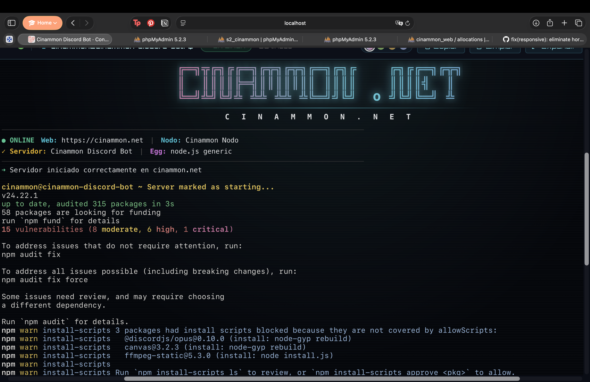
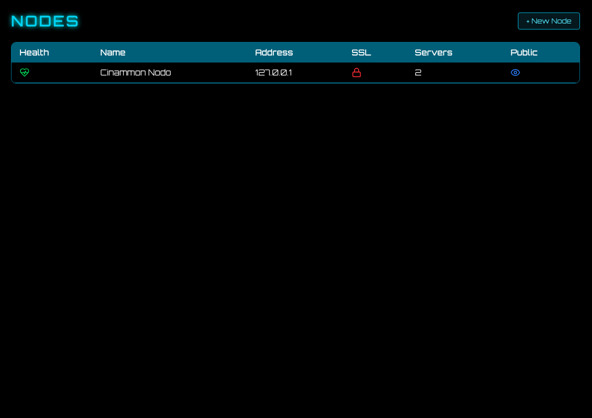
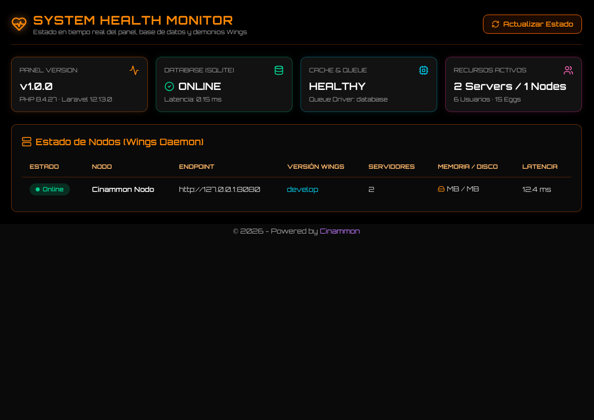
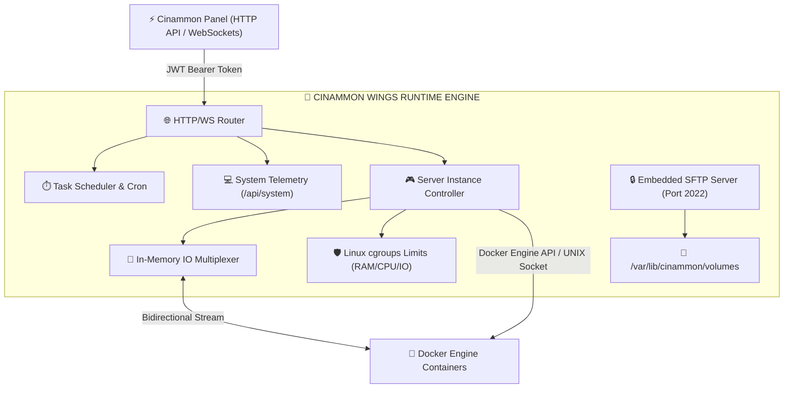

<p align="center">
  <pre align="center">
<font color="#00f7ff"><b>╦ ╦╦╔╗╔╔═╗╔═╗  ╔╦╗╔═╗╔═╗╔╦╗╔═╗╔╗╔</b></font>
<font color="#10b981"><b>║║║║║║║║ ╦╚═╗   ║║╠═╣║╣ ║║║║ ║║║║</b></font>
<font color="#f472b6"><b>╚╩╝╩╝╚╝╚═╝╚═╝  ═╩╝╩ ╩╚═╝╩ ╩╚═╝╝╚╝</b></font>
  </pre>
  <p align="center">
    <b><code>// HIGH-PERFORMANCE GO CONTAINER ENGINE & ISOLATED RUNTIME DAEMON //</code></b>
  </p>
  <p align="center">
    <a href="https://github.com/cinammon-net/wings"></a>
    <a href="https://github.com/cinammon-net/wings"></a>
    <a href="https://github.com/cinammon-net/wings"></a>
    <a href="https://github.com/cinammon-net/wings"></a>
  </p>
</p>

---

## ⚡ // 01. DAEMON TELEMETRY & RUNTIME VISUALS

<div align="center">
  <p><b>🚀 REAL-TIME STREAMING & LOW-LATENCY TELEMETRY</b></p>
  
  <p><i>Flujo bidireccional mediante WebSockets a 60 FPS: comandos stdin, streams stdout/stderr filtrados y estados de contenedor.</i></p>
</div>

<br />

<div align="center">
  <table width="100%">
    <tr>
      <td width="50%" align="center">
        <b>🛰️ NODE CLUSTERING & HEARTBEATS</b><br /><br />
        <br />
        <sub>Sincronización de credenciales JWT, puertos SFTP y certificados TLS por nodo.</sub>
      </td>
      <td width="50%" align="center">
        <b>📊 HARDWARE QUOTA & CGROUPS MONITOR</b><br /><br />
        <br />
        <sub>Control estricto de cgroups v1/v2: CPU throttling, contención de RAM y cuotas de disco.</sub>
      </td>
    </tr>
  </table>
</div>

---

## 🛰️ // 02. INTERNALS & DAEMON ARCHITECTURE



---

## 🔮 // 03. CYBERNETIC CAPABILITIES

* **⚡ Zero Overhead Go Core**: Construido enteramente en Golang nativo, optimizado para concurrencia masiva con miles de goroutines y consumo mínimo de memoria RAM (< 50 MB en reposo).
* **🔒 Servidor SFTP Nativo Embebido**: Olvídate de configurar OpenSSH o demonios externos. Wings integra un subsistema SFTP criptográfico que autentica usuarios directamente contra el token del [Cinammon Panel](https://github.com/cinammon-net/panel).
* **🛡️ Cgroups v1 & v2 Hard Isolation**: Cumplimiento riguroso de límites de hardware. Si un servidor excede su cuota de memoria, el kernel es instruido para prevenir kernel panics en el nodo host.
* **🌐 WebSockets Multiplexados**: Transmisión de consola en tiempo real, eventos de arranque/parada, monitoreo de uso de recursos y control de energía sin recargas ni latencia.
* **📦 Copias de Seguridad Cifradas**: Creación de archivos comprimidos de alta velocidad transmitidos a almacenamiento local o proveedores S3 compatibles.

---

## 🛠️ // 04. COMPILATION & DAEMON SETUP

### Requisitos del Nodo Host
* **Sistema Operativo**: Linux (Debian 12+, Ubuntu 22.04+, RHEL 9+, Alpine Linux) o macOS (desarrollo con Lima VM)
* **Kernel**: Linux 5.15+ con módulos cgroups habilitados
* **Go**: 1.23+ (solo para compilación desde fuente)
* **Docker**: Docker Engine 24.0+ con `systemd` cgroup driver

### Compilación desde Fuente

```bash
# 1. Clonar el repositorio
git clone https://github.com/cinammon-net/wings.git
cd wings

# 2. Descargar módulos de Go
go mod download

# 3. Compilar el binario optimizado
make build

# O compilar directamente con el compilador de Go:
CGO_ENABLED=0 go build -ldflags="-s -w" -o build/wings .
```

### Configuración del Daemon (`/etc/cinammon/config.yml`)

Descarga el archivo YAML desde el Panel de Cinammon (`Nodos -> Tu Nodo -> Configuration File`):

```yaml
debug: false
uuid: 1337cafe-0000-0000-0000-000000000001
token_id: cinammon_token_id
token: cinammon_cluster_secret_key
api:
  host: 0.0.0.0
  port: 8080
  ssl:
    enabled: false
system:
  data: /var/lib/cinammon/volumes
  sftp:
    bind_port: 2022
remote: 'http://127.0.0.1:8000'
```

### Servicio Systemd (`/etc/systemd/system/wings.service`)

```ini
[Unit]
Description=Cinammon Wings Daemon
After=docker.service
Requires=docker.service

[Service]
User=root
WorkingDirectory=/etc/cinammon
LimitNOFILE=4096
PIDFile=/var/run/wings/daemon.pid
ExecStart=/usr/local/bin/wings
Restart=on-failure
StartLimitInterval=180
StartLimitBurst=30
RestartSec=5s

[Install]
WantedBy=multi-user.target
```

```bash
systemctl daemon-reload
systemctl enable --now wings
```

---

## 📡 // 05. ECOSYSTEM MATRIX

| Repositorio | Función | Stack Tecnológico |
| :--- | :--- | :--- |
| **[cinammon-net/wings](https://github.com/cinammon-net/wings)** | Daemon de alto rendimiento, comunicación WebSocket y SFTP | Golang 1.23, Docker Engine API, WebSockets |
| **[cinammon-net/panel](https://github.com/cinammon-net/panel)** | Orquestador principal, interfaz de administración y consola cyber | Laravel 11, React 18, Inertia.js, TailwindCSS |
| **[cinammon-net/billing](https://github.com/cinammon-net/billing)** | Portal de clientes, tienda de planes automatizada y pasarelas | Laravel 11, Inertia.js, TailwindCSS, Fortify 2FA |
| **[cinammon-net/eggs](https://github.com/cinammon-net/eggs)** | Catálogo de más de 129 plantillas de instalación y ejecución | Dockerfiles, Bash Scripts, JSON Blueprints |

---

<p align="center">
  <sub>Cinammon.net // Low-Latency Go Virtualization // 2026</sub>
</p>
